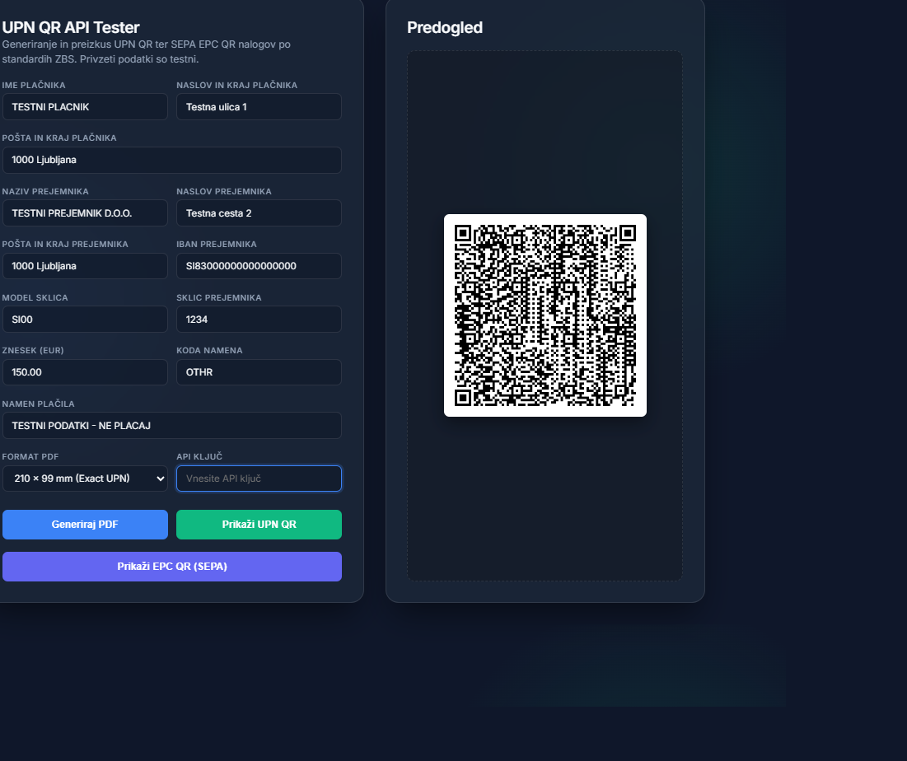
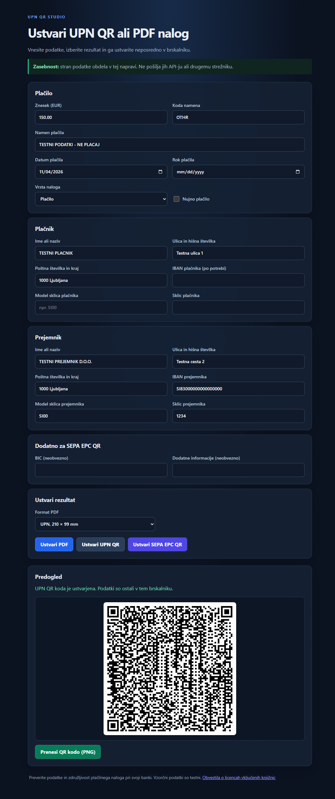

# UPN QR API — Navodila za uporabo in dokumentacija

Node.js (Fastify) REST API za validacijo in paketno generiranje slovenskih plačilnih nalogov **UPN QR** po standardu Združenja bank Slovenije (ZBS) ter evropskih **SEPA EPC QR** kod.

---

## Kazalo vsebine
1. [Hitri zagon (Za začetnike)](#1-hitri-zagon-za-začetnike)
   - [Samostojen tester na GitHub Pages](#samostojen-tester-na-github-pages)
2. [Avtentikacija (API ključ)](#2-avtentikacija-api-ključ)
3. [Tabela vseh polj in format podatkov](#3-tabela-vseh-polj-in-format-podatkov)
4. [Praktični primeri klicev](#4-praktični-primeri-klicev)
   - [A. Enojni nalog (PDF 210 × 99 mm)](#primer-a-enojni-nalog-točne-dimenzije-210--99-mm)
   - [B. Enojni nalog na dnu A4 lista](#primer-b-enojni-nalog-na-dnu-a4-lista)
   - [C. Več zaporednih računov: 3 položnice na 1 A4 stran (a4-triple)](#primer-c-več-zaporednih-računov--3-upn-nalogi-na-1-a4-poli-a4-triple)
   - [D. Več zaporednih računov v ZIP arhiv](#primer-d-več-zaporednih-računov-v-ločenih-datotekah-zip-arhiv)
   - [E. Generiranje UPN QR kode (PNG / SVG)](#primer-e-generiranje-samo-upn-qr-kode-png-ali-svg)
   - [F. Generiranje evropske SEPA EPC QR kode](#primer-f-generiranje-evropske-sepa-epc-qr-kode)
5. [Primeri integracije v programskih jezikih](#5-primeri-integracije-v-programskih-jezikih)
   - [Node.js / JavaScript](#nodejs--javascript)
   - [Python](#python)
   - [PHP](#php)
6. [Kaj se zgodi, če gre kaj narobe? (Diagnostika napak)](#6-kaj-se-zgodi-če-gre-kaj-narobe-diagnostika-napak)
7. [Pogosta vprašanja in pravila standarda ZBS](#7-pogosta-vprašanja-in-pravila-standarda-zbs)
8. [Zagon v produkciji (Docker & Okoljske spremenljivke)](#8-zagon-v-produkciji-docker--okoljske-spremenljivke)
9. [Licenca](#9-licenca)

---

## 1. Hitri zagon (Za začetnike)

### Korak 1: Namestitev in lokalni zagon (Windows PowerShell)
Za lokalni zagon potrebujete Node.js 24 ali novejši. V mapi projekta odprite
PowerShell in namestite odvisnosti:

```bash
npm ci
```

Ustvarite zasebno konfiguracijo `.env` (ta datoteka je izključena iz Gita):

```powershell
if (-not (Test-Path .env)) {
    Copy-Item .env.example .env
    $key = [guid]::NewGuid().ToString('N') + [guid]::NewGuid().ToString('N')
    $lines = (Get-Content .env) -replace '^API_KEY=.*$', "API_KEY=$key"
    [System.IO.File]::WriteAllLines((Join-Path (Get-Location) '.env'), $lines, [System.Text.Encoding]::ASCII)
}
$apiKey = (Get-Content .env | Where-Object { $_ -match '^API_KEY=' }) -replace '^API_KEY=', ''
if (-not $apiKey) { throw 'V .env manjka API_KEY.' }
Set-Clipboard -Value $apiKey
```

Ključ je kopiran v odložišče; prilepite ga samo v lokalni tester. Ne izpisujte
ga in ga ne prilepite v javno kodo, GitHub ali Pages. Zaženite strežnik:

```powershell
npm start
```

Strežnik privzeto posluša samo na vašem računalniku: **`http://127.0.0.1:3000`**.
`npm start` samodejno prebere `.env`; ključa ne objavite in ga ne vstavite v
javno spletno stran.

### Korak 2: Grafični testni vmesnik
Ko strežnik teče, v svojem spletnem brskalniku odprite:
👉 **`http://127.0.0.1:3000`**

V vgrajenem grafičnem vmesniku lahko takoj preizkusite generiranje PDF naloga, UPN QR kode ali SEPA EPC QR kode brez pisanja ukazov.
V polje **API ključ** vnesite isto vrednost, kot je nastavljena v `API_KEY`
na strežniku. Tester jo pošlje v glavi `Authorization: Bearer <API_KEY>`;
ključa ne vdelujte v javno HTML-stran ali repozitorij.

V spodnjem delu testerja lahko naložite CSV/JSON datoteko ali izberete primer.
Pred pošiljanjem se podatki prikažejo v predogledu; API nato preveri vse naloge
in ustvari združen PDF ali ZIP. Za lokalni preizkus vnesite ključ iz `.env`.
Datoteka in ključ se ne shranjujeta v brskalnik; podatki se pošljejo samo API-ju,
ko izberete izdelavo.



### Samostojen tester na GitHub Pages

Mapa `pages/` vsebuje ločen statični tester. Obrazec ustvari UPN QR, SEPA EPC QR
in PDF neposredno v brskalniku; ne kliče tega API-ja, ne potrebuje API-ključa
in ne pošilja podatkov na strežnik. GitHub Pages gosti samo tester, ne API-ja.

Za lokalni preizkus:
```bash
npm ci
npm run build:pages
```
Nato odprite `_site/index.html`. Ustvarjena spletna stran ne nalaga zunanjih
virov z drugih spletnih mest.

Za objavo na GitHub Pages:
1. V repozitoriju odprite **Settings → Pages** in pri viru objave izberite **GitHub Actions**.
2. Objavite spremembe v veji `main` na GitHubu.
3. Po uspešnem zagonu opravila **Deploy browser tester to GitHub Pages** bo stran na
   `https://mihaknific.github.io/upn-qr-api/`.

GitHub Pages je lahko brezplačen v okviru takrat veljavnih GitHubovih pogojev
in omejitev; pred objavo preverite aktualni paket in nastavitve računa. Ta
objava ne zažene API-strežnika; za programske HTTP zahtevke bo še vedno
potreben backend. API-strežnik se ne objavi z GitHub Pages; za njegovo
gostovanje je potrebna ločena odločitev in varna nastavitev strežniškega
API-ključa.



### Razlika med API-jem, testerjem in UPN Studio

- HTTP API je namenjen programskim klicem in sprejema JSON. Endpoint `/api/batch`
  sprejme do 500 nalogov; privzeta omejitev telesa zahteve je 10 MiB.
- Lokalni tester API-ja sprejme JSON ali CSV datoteko do 2 MB in do 500 nalogov;
  pri CSV-ju uporablja UTF-8 in imena polj API-ja. CSV pretvori v JSON pred
  pošiljanjem na lokalni strežnik.
- UPN Studio je ločena brskalniška aplikacija, ki naloge izdela lokalno in ne
  potrebuje API ključa ali API strežnika. Njegov uvoz sprejme do 500 nalogov in
  5 MB; CSV podpira tudi vzdevke stolpcev ter UTF-8/Windows-1250. Ne gre za
  deljeni strežniški endpoint.

Različni limiti in načini uvoza so namerni: CSV je priročen za človeka, JSON pa
ostaja stabilna oblika programskega vmesnika.

---

## 2. Avtentikacija (API ključ)

Vsak API zahtevek razen javnih health endpointov `/health` in `/api/health` mora vsebovati HTTP glavo:
```http
Authorization: Bearer <API_KEY>
```

Če `API_KEY` ni nastavljen, zaščitene poti vrnejo `503 Service Unavailable`. V testnem vmesniku vnesite isti ključ.
To velja za lokalni vmesnik API-ja; samostojni tester na GitHub Pages API-ključa ne uporablja.
API-ključ je geslo za dostop do strežnika, ne način zaračunavanja in ne račun
za vsakega končnega uporabnika posebej. Pri lokalnem zagonu ga ustvariš zase.
Nikoli ga ne vgradi v javni brskalniški odjemalec; javno gostovanje potrebuje
ločeno odločitev o dostopu, omejitvah in zaščiti pred zlorabo.

---

## 3. Tabela vseh polj in format podatkov

API sprejema podatke v standardnem formatu **JSON**. Spodnja tabela prikazuje vsa polja, omejitve in pravila:

| Polje | Tip | Obvezno? | Maks. dolžina | Opis in primer |
|---|---|:---:|:---:|---|
| `amount` | string / number | **DA**\* | 11 mest | Znesek v EUR z največ 2 decimalnima mestoma (npr. `"150.00"` ali `150.50`). (\*Pri humanitarnem načinu je lahko `"0"`). |
| `payerName` | string | **DA**\* | 33 znakov | Ime in priimek ali naziv plačnika (npr. `"JANEZ NOVAK"`). |
| `payerAddress` | string | **DA**\* | 33 znakov | Ulica in hišna številka plačnika (npr. `"SLOVENSKA CESTA 1"`). |
| `payerCity` (ali `payerPlace`) | string | **DA**\* | 33 znakov | Poštna številka in kraj plačnika (npr. `"1000 LJUBLJANA"`). |
| `payerIban` | string | Ne / Da\* | 19 znakov | Slovenski IBAN plačnika. Obvezen le pri dvigu gotovine. Pri pologu in humanitarnem načinu je strogo prepovedan. |
| `payerRefCode` | string | Ne | 4 znaki | Model sklica plačnika (npr. `"SI00"`). |
| `payerRef` | string | Ne | 20 znakov | Sklic plačnika (npr. `"1234"`). |
| `recipientName` | string | **DA**\* | 33 znakov | Naziv prejemnika plačila (npr. `"ELEKTRO LJUBLJANA D.D."`). |
| `recipientAddress` | string | **DA**\* | 33 znakov | Ulica in hišna številka prejemnika (npr. `"SLOVENSKA CESTA 58"`). |
| `recipientCity` (ali `recipientPlace`) | string | **DA**\* | 33 znakov | Poštna številka in kraj prejemnika (npr. `"1000 LJUBLJANA"`). |
| `recipientIban` | string | **DA**\* | 34 znakov | Veljaven SEPA IBAN prejemnika (npr. `"SI56020170014356205"`). Pri dvigu gotovine je prepovedan. |
| `recipientRefCode` | string | Ne / Da\* | 4 znaki | Model sklica prejemnika (npr. `"SI00"`, `"SI12"`, `"RF"`). Obvezen pri humanitarnem načinu in pri računih JFP (`SI56 01...`). |
| `recipientRef` | string | Ne / Da\* | 20 znakov | Vsebina sklica prejemnika (npr. `"2026-1001"`). |
| `purposeCode` | string | **DA** | 4 znaki | 4-mestna koda namena po uradnem šifrantu ZBS (npr. `"GDSV"`, `"OTHR"`, `"COST"`, `"RENT"`). |
| `purpose` | string | **DA** | 42 znakov | Namen plačila (npr. `"STORITVE ZA MESEC OKTOBER 2026"`). |
| `paymentDate` | string | Ne / Da\* | 10 znakov | Datum plačila v obliki `YYYY-MM-DD` (npr. `"2026-11-05"`). Prepovedan pri humanitarnem nalogu. |
| `dueDate` | string | Ne | 10 znakov | Rok plačila v obliki `YYYY-MM-DD` (npr. `"2026-11-20"`). |
| `nujno` (ali `urgent`) | boolean | Ne | - | Označi nujno nakazilo (`true` / `false`). Prepovedano pri humanitarnem načinu, pologu in dvigu. |
| `mode` | string | Ne | - | Način naloga: `"placilo"` (privzeto), `"humanitarno"`, `"polog"`, `"dvig"`. |
| `currency` | string | Ne | 3 znaki | Valuta, privzeto `"EUR"`. |
| `epcBic` | string | Ne | 8 ali 11 | BIC/SWIFT koda banke za SEPA EPC QR kodo (npr. `"LJBASI2X"`). |
| `epcInformation` | string | Ne | 70 znakov | Dodatne informacije za SEPA EPC QR kodo. |

---

## 4. Praktični primeri klicev

V mapi projekta so pripravljeni vzorčni podatki:
- **`primer-enojni-nalog.json`**
- **`primer-batch-3-racuni.json`**
- **`primer-batch-3-racuni.csv`** — CSV predloga z ločilom `;`.

Vzorčni nalogi uporabljajo izmišljene podatke in so označeni **NE PLAČAJ**.
Ne uporabljajte jih za dejansko plačilo. CSV lahko odprete v preglednici;
stolpci imajo enaka imena kot JSON polja. Ker je ločilo podpičje, lahko znesek
z decimalno vejico zapišete brez dodatnih narekovajev. Pri svoji datoteki
uporabite enako glavo stolpcev. Podprta sta vejica in podpičje; besedilo, ki
vsebuje ločilo ali novo vrstico, postavite v narekovaje. Pri CSV-ju z vejico
kot ločilom znesek z decimalno vejico prav tako postavite v narekovaje; za
slovenske preglednice je priporočeno podpičje kot ločilo. Datoteko shranite
kot CSV v UTF-8. Izbirna logična polja
`urgent`, `nujno`, `polog`, `dvig` in `humanitarno` sprejmejo `true`/`false`,
`1`/`0` ali `da`/`ne`; prazno celico izpustijo.

Testni vmesnik sprejme do 500 nalogov in datoteke do 2 MB. Strukturne napake
CSV/JSON se pokažejo pred pošiljanjem; napake UPN polj API vrne po vrsticah.

### Primer A: Enojni nalog točne dimenzije (210 × 99 mm)
Primeren za tisk na originalne perforirane obrazce UPN:
```bash
curl -X POST http://127.0.0.1:3000/api/pdf \
  -H "Authorization: Bearer <API_KEY>" \
  -H "Content-Type: application/json" \
  -d @primer-enojni-nalog.json \
  --output moj-nalog.pdf
```

### Primer B: Enojni nalog na dnu A4 lista
Primeren za neposreden tisk na prazen papir A4 (spodaj položnica, zgoraj prostor za račun):
```bash
curl -X POST http://127.0.0.1:3000/api/pdf/a4 \
  -H "Authorization: Bearer <API_KEY>" \
  -H "Content-Type: application/json" \
  -d @primer-enojni-nalog.json \
  --output moj-racun-a4.pdf
```

### Primer C: VEČ ZAPOREDNIH RAČUNOV — 3 UPN nalogi na 1 A4 poli (`a4-triple`)
**Uporaben format za podjetja in izdajatelje položnic.**
Če pošljete npr. 30 računov, API ustvari PDF z natanko 10 stranmi (po 3 položnice na stran s perforacijskimi črtami):

```bash
curl -X POST http://127.0.0.1:3000/api/batch \
  -H "Authorization: Bearer <API_KEY>" \
  -H "Content-Type: application/json" \
  -d "{\"format\":\"a4-triple\",\"merge\":true,\"nalogi\":$(Get-Content primer-batch-3-racuni.json -Raw)}" \
  --output poloznice-3-na-stran.pdf
```

### Primer D: VEČ ZAPOREDNIH RAČUNOV v ločenih datotekah (ZIP arhiv)
Če želite za vsakega kupca dobiti svojo ločeno PDF datoteko, zapakirano v en ZIP arhiv:
```bash
curl -X POST http://127.0.0.1:3000/api/batch \
  -H "Authorization: Bearer <API_KEY>" \
  -H "Content-Type: application/json" \
  -d "{\"format\":\"exact\",\"merge\":false,\"nalogi\":$(Get-Content primer-batch-3-racuni.json -Raw)}" \
  --output vsi-racuni.zip
```
*Vrne ZIP arhiv z datotekami `001_2026-1001.pdf`, `002_2026-1002.pdf`, itd.*

### Primer E: Generiranje samo UPN QR kode (PNG ali SVG)
Če želite QR kodo vdelati v svoj obstoječi račun:
```bash
# PNG slika
curl -X POST http://127.0.0.1:3000/api/qr \
  -H "Authorization: Bearer <API_KEY>" \
  -H "Content-Type: application/json" \
  -d @primer-enojni-nalog.json \
  --output qr-koda.png

# Vektorska SVG slika
curl -X POST "http://127.0.0.1:3000/api/qr?format=svg" \
  -H "Authorization: Bearer <API_KEY>" \
  -H "Content-Type: application/json" \
  -d @primer-enojni-nalog.json \
  --output qr-koda.svg
```

### Primer F: Generiranje evropske SEPA EPC QR kode
```bash
curl -X POST http://127.0.0.1:3000/api/epc-qr \
  -H "Authorization: Bearer <API_KEY>" \
  -H "Content-Type: application/json" \
  -d @primer-enojni-nalog.json \
  --output epc-qr.png
```

---

## 5. Primeri integracije v programskih jezikih

### Node.js / JavaScript
```javascript
import fs from 'fs';

const podatekONalogu = {
    amount: "45.00",
    payerName: "MATEJ KRAJC",
    payerAddress: "SLOVENSKA 10",
    payerCity: "1000 LJUBLJANA",
    recipientName: "PODJETJE D.O.O.",
    recipientAddress: "DUNAJSKA 20",
    recipientCity: "1000 LJUBLJANA",
    recipientIban: "SI56020170014356205",
    recipientRefCode: "SI00",
    recipientRef: "2026-99",
    purposeCode: "GDSV",
    purpose: "STORITVE PROGRAMIRANJA",
    paymentDate: "2026-11-05"
};

const response = await fetch('http://127.0.0.1:3000/api/pdf', {
    method: 'POST',
    headers: {
        'Content-Type': 'application/json',
        'Authorization': 'Bearer <API_KEY>'
    },
    body: JSON.stringify(podatekONalogu)
});

if (response.ok) {
    const buffer = Buffer.from(await response.arrayBuffer());
    fs.writeFileSync('nalog.pdf', buffer);
    console.log('PDF nalog uspešno shranjen v nalog.pdf');
} else {
    const napaka = await response.json();
    console.error('Napaka pri izdelavi naloga:', napaka);
}
```

### Python
```python
import requests

podatki = {
    "amount": "120.00",
    "payerName": "ANA NOVAK",
    "payerAddress": "TISOVEC 4",
    "payerCity": "1310 RIBNICA",
    "recipientName": "KOMUNALA D.O.O.",
    "recipientAddress": "GORIŠKA 1",
    "recipientCity": "1000 LJUBLJANA",
    "recipientIban": "SI56020170014356205",
    "recipientRefCode": "SI00",
    "recipientRef": "554433",
    "purposeCode": "OTHR",
    "purpose": "ODVOZ ODPADKOV ZA OKTOBER",
    "paymentDate": "2026-11-15"
}

headers = {
    "Authorization": "Bearer <API_KEY>",
    "Content-Type": "application/json"
}

odgovor = requests.post("http://127.0.0.1:3000/api/pdf", json=podatki, headers=headers)

if odgovor.status_code == 200:
    with open("nalog.pdf", "wb") as f:
        f.write(odgovor.content)
    print("PDF shranjen!")
else:
    print("Napaka:", odgovor.status_code, odgovor.json())
```

### PHP
```php
<?php
$podatki = [
    'amount' => '85.50',
    'payerName' => 'JANEZ VZOREC',
    'payerAddress' => 'CESTA 1',
    'payerCity' => '2000 MARIBOR',
    'recipientName' => 'ELEKTRO STORITVE D.O.O.',
    'recipientAddress' => 'DUNAJSKA 15',
    'recipientCity' => '1000 LJUBLJANA',
    'recipientIban' => 'SI56020170014356205',
    'recipientRefCode' => 'SI00',
    'recipientRef' => '2026-123',
    'purposeCode' => 'GDSV',
    'purpose' => 'RACUN 2026-123',
    'paymentDate' => '2026-11-10'
];

$ch = curl_init('http://127.0.0.1:3000/api/pdf');
curl_setopt($ch, CURLOPT_POST, true);
curl_setopt($ch, CURLOPT_POSTFIELDS, json_encode($podatki));
curl_setopt($ch, CURLOPT_RETURNTRANSFER, true);
curl_setopt($ch, CURLOPT_HTTPHEADER, [
    'Content-Type: application/json',
    'Authorization: Bearer <API_KEY>'
]);

$rezultat = curl_exec($ch);
$httpStatus = curl_getinfo($ch, CURLINFO_HTTP_CODE);
curl_close($ch);

if ($httpStatus === 200) {
    file_put_contents('nalog.pdf', $rezultat);
    echo "PDF uspesno ustvarjen!\n";
} else {
    echo "Napaka: " . $rezultat . "\n";
}
```

---

## 6. Kaj se zgodi, če gre kaj narobe? (Diagnostika napak)

Pri neveljavnih podatkih API vrne ustrezno HTTP statusno kodo in opis napake v JSON:

### 1. Napaka pri validaciji podatkov enega naloga (`400 Bad Request`)
Če katerikoli podatek ni skladen s standardom ZBS (npr. neveljaven IBAN ali napačna kontrolna številka v sklicu):

```json
{
  "error": "Validation failed",
  "details": [
    {
      "field": "recipientIban",
      "msg": "Neveljaven IBAN prejemnika."
    },
    {
      "field": "amount",
      "msg": "Znesek je obvezen."
    }
  ]
}
```
**Rešitev:** Popravite navedena polja v `details` in ponovite zahtevek.

---

### 2. Napaka v seriji računov (`400 Bad Request` pri `/api/batch`)
Če pošljete paket 100 računov in ima npr. 12. račun napako, API natančno identificira sporni račun:

```json
{
  "error": "Batch validation failed",
  "totalItems": 100,
  "failedCount": 1,
  "details": [
    {
      "index": 11,
      "itemNumber": 12,
      "payer": "MARKO HORVAT",
      "recipient": "TELEKOMUNIKACIJE D.O.O.",
      "errors": [
        {
          "field": "recipientRef",
          "msg": "Neveljavna SI referenca (prejemnika). Preverite model, obliko, dolžino in kontrolno številko."
        }
      ]
    }
  ]
}
```
**Prednost:** Točno veste, katero vrstico v vaši bazi podatkov morate popraviti (`itemNumber: 12`, plačnik Marko Horvat).

---

### 3. Manjkajoča ali neveljavna avtentikacija (`401 Unauthorized` ali `403 Forbidden`)
- Če pozabite poslati glavo `Authorization`:
  ```json
  {
    "error": "Unauthorized",
    "message": "Missing or invalid Authorization header"
  }
  ```
- Če je ključ napačen:
  ```json
  {
    "error": "Forbidden",
    "message": "Invalid API key."
  }
  ```
**Rešitev:** Nastavite `API_KEY` na strežniku in pošljite glavo `Authorization: Bearer <API_KEY>`.

---

### 4. Napačen URL naslov (`404 Not Found`)
Če se zmotite pri naslovu endpointa, API izpiše seznam vseh razpoložljivih poti:
```json
{
  "error": "Not Found",
  "message": "Zahtevana pot 'POST /api/generiraj-pdf' ne obstaja.",
  "razpolozljivePoti": [
    "GET  /health",
    "GET  /api/health",
    "POST /api/validate",
    "POST /api/pdf",
    "POST /api/pdf/a4",
    "POST /api/qr",
    "POST /api/epc-qr",
    "POST /api/batch"
  ]
}
```

---

### 5. Prevelik paket podatkov (`413 Payload Too Large`)
Če v `/api/batch` pošljete izjemno veliko število računov, ki presega nastavljen limit pomnilnika.
**Rešitev:** Zvišajte okoljsko spremenljivko `BODY_LIMIT` (npr. `BODY_LIMIT=20971520` za 20 MB).

---

### 6. Presežena omejitev klicev (`429 Too Many Requests`)
Če vaša avtomatizacija pošlje več klicev na minuto, kot je dovoljeno.
**Rešitev:** Po potrebi prilagodite `RATE_LIMIT_MAX` (privzeto 100 zahtevkov/minuto).

---

## 7. Pogosta vprašanja in pravila standarda ZBS

### Kako delujejo slovenski šumniki (Č, Š, Ž)?
- Standard ZBS UPN QR predpisuje nabor znakov **ISO-8859-2**.
- Vsi slovenski šumniki (`Č`, `Š`, `Ž`, `č`, `š`, `ž`) so **popolnoma podprti** v kodi QR in na tiskanem nalogu.
- Posebni znaki (npr. emojiji `🙂` ali cirilične/azijske pismenke) niso podprti v ISO-8859-2 in jih validator zavrne, da se prepreči izdelava nečitljive QR kode na bančnem okencu ali v mobilni banki.

### Zakaj je koda modela ločena od sklica?
V JSON strukturi sta model in sklic ločena v dve polji:
- `recipientRefCode`: `"SI00"` (ali `"SI12"`, `"RF"`, itd.)
- `recipientRef`: `"1234-5678"`

### Katerih modelov sklica podjetja NE smejo uporabljati?
- Modela **`SI22`** in **`SI32`** sta po pravilih ZBS rezervirana izključno za FURS (Finančno upravo RS).
- Model **`SI58`** je rezerviran za Enotni zakladniški račun (EZR).
- API samodejno zavrne uporabo teh modelov v splošnih nalogih.

### Kaj je posebnost računov JFP (`SI56 01...`)?
Če plačujete na račun javnofinančnih prihodkov (začne se z `SI56 01`), je vpis modela in veljavnega sklica po zakonu **strogo obvezen**. Brez sklica banka plačila ne more razknjižiti.

### Znesek: pika ali vejica?
API sprejema obe obliki (`"150.50"` ali `"150,50"` ali številko `150.50`). Na samem nalogu se vedno izpiše v uradni slovenski obliki s tremi zvezdicami (npr. `***150,50`).

---

## 8. Zagon v produkciji (Docker & Okoljske spremenljivke)

### Okoljske spremenljivke

| Spremenljivka | Privzeta vrednost | Opis |
|---|---|---|
| `PORT` | `3000` | Omrežna vrata, na katerih posluša strežnik |
| `HOST` | `127.0.0.1` | Lokalni zagon posluša samo na tem računalniku; Docker ga nastavi na `0.0.0.0` |
| `API_KEY` | Brez privzete vrednosti | Obvezen ključ za zaščitene API poti; brez njega te poti vrnejo 503 |
| `BODY_LIMIT` | `10485760` (10 MB) | Maksimalna velikost JSON paketa v bajtih |
| `RATE_LIMIT_MAX` | `100` | Dovoljeno število zahtevkov na minuto |
| `RATE_LIMIT_WINDOW` | `1 minute` | Časovno okno za omejevanje zahtevkov |
| `LOG_LEVEL` | `warn` | Nivo beleženja dnevnikov (`info`, `warn`, `error`) |
| `CORS_ORIGIN` | Ni omogočen | Dovoli CORS za navedene izvore, ločene z vejico; brez nastavitve so dovoljeni le istovrstni klici |
| `TRUSTED_PROXIES` | Ni zaupanja vrednih proxyjev | Seznam IP naslovov ali omrežij proxyjev, ločenih z vejico |

### Zagon prek Dockerja

```powershell
# Ustvarite naključen ključ za ta zagon; ne objavite ali delite njegove vrednosti.
$env:API_KEY = [guid]::NewGuid().ToString('N') + [guid]::NewGuid().ToString('N')

# 1. Zgradite Docker sliko
docker build -t upn-qr-api .

# 2. Zaženite vsebnik z API ključem na vratih 3000
docker run -d --name upn-api -p 3000:3000 -e "API_KEY=$env:API_KEY" --restart unless-stopped upn-qr-api
```

Preverite stanje delovanja:
```bash
curl http://127.0.0.1:3000/health
# Vrne: {"status":"ok","timestamp":"2026-11-03T11:00:00.000Z"}
```

---

## 9. Licenca

Repozitorij uporablja [PolyForm Noncommercial License 1.0.0](./LICENSE).
Licenca dovoljuje uporabo, spreminjanje in razširjanje za nekomercialne namene
pod pogoji licence. Komercialna uporaba ni dovoljena brez ločenega dovoljenja
licencodajalca. Licenca ne zahteva, da spremembe pošljete projektu. PolyForm
Noncommercial ni odprtokodna licenca, odobrena s strani OSI. Tretjeosebne
komponente ostajajo pod svojimi licencami.
